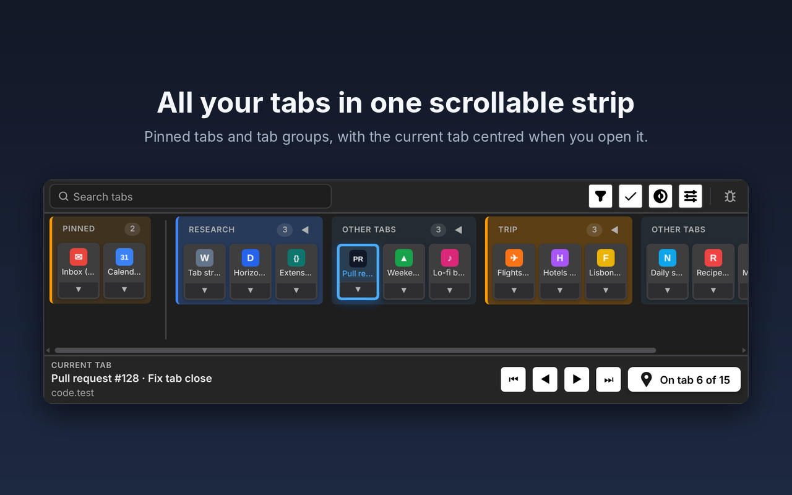

# Scrollable-tabs-extension 


Chrome extension that mimics scrollable tab strip experimental feature of chrome (chrome://flags/#scrollable-tabstrip).

A Chrome extension that provides a horizontal, scrollable view of all open tabs in a popup window.

Made with AI and human touch <3.

## Features

- **Horizontal scrollable list** of all tabs, with pinned tabs and tab groups (names and colours)
- **Auto-focus on active tab** when popup opens
- **Click to switch** tabs
- **Real-time synchronization** with browser tab changes
- **Visual indicators** for audio playing and muted tabs
- **Hover info**: hovering a tab shows its full title and site in place of the current tab's
- **Search as you type**: start typing anywhere in the popup; Enter opens the first match
- **Filter tabs** by audio (playing or muted), pinned, grouped, or ungrouped status
- **Multi-select** (Ctrl/Cmd+click, Shift+click for ranges, Ctrl/Cmd+A) with batch close, mute, pin, **move to front** (right after pinned tabs) and move to a new window. Batch actions only touch tabs you can see, and closing many tabs asks for confirmation
- **Middle-click** a tab to close it; collapsed groups stay collapsed while the popup is open
- **Light / dark / system theme** and adjustable popup width, scroll speed and display options
- **Bug report / feedback form** that opens a pre-filled GitHub issue (no data is sent until you submit it there)

Keyboard shortcuts are listed on the settings page.



Website: https://skm162.github.io/Scrollable-tabs-extension/ · [Privacy policy](https://skm162.github.io/Scrollable-tabs-extension/privacy.html)

## Installation

Get it from [Chrome web store](https://chromewebstore.google.com/detail/scrollable-tabs/beneiafglkilogdikodimmbmnkbpnnba)

OR

### Load Extension locally:
Official reference: https://developer.chrome.com/docs/extensions/get-started/tutorial/hello-world#load-unpacked
1. Clone or download and extract the repository.
1. Open Chrome and navigate to `chrome://extensions/`
2. Enable "Developer mode" (toggle icon at top right)
3. Click "Load unpacked" (at top left)
4. Select the extension directory cloned or downloaded.

### Build the Chrome Web Store package
```sh
./scripts/package.sh   # -> dist/scrollable-tabs-<version>.zip (runtime files only)
```
Listing text, permission justifications and screenshots are in [`store/`](store/listing.md).

## Usage

Click the extension icon in the Chrome toolbar to open the tab navigator popup. The active tab will be automatically be focussed.

### Current Status (will be removed once stable at basic level.)

**Phase 1 (MVP) - ✅ Complete**
- Base popup with horizontal tab list
- Click to switch tabs
- Auto-center on active tab
- Real-time tab sync
- Tab group support

**Phase 2 - ✅ Complete**
- Navigation
- Basic settings (popup window size, auto focus on current tab, tab titles, current tab count)
- Basic tab menu options (close, pin/unpin, mute/unmute)

**Phase 3 - ✅ Complete**
- Better UI/UX for tab menu options
- fix scroll focus change after tab closing and tab not closing sometimes.
- fix smooth scrolling
- fix loading of thumbnails at each start, caching implemented.
- fix group closing icons
- Light/dark theme support
- new tab creation
- fix picture in picture handling (tab's pip status not supported by chrome.). fixed audio playing indication.

**Phase 4 - ✅ Complete**
- filtering tabs

**Phase 5 - in progress**
- ✅ tab search
- ✅ multi-select with batch actions (close, mute, pin, move to front, move to new window)
- tab reordering (move to front done)
- AI tab organization

## Contributions are welcomed!

# Attributions
Default thumbnail for tabs - [By Sarang - Own work, Public Domain](https://commons.wikimedia.org/w/index.php?curid=18827703)

## License

Apache License 2.0 — see [LICENSE](LICENSE).
